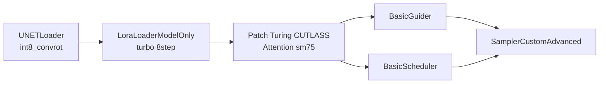

# 07 · 节点接线

## 正确的 MODEL 链



三条规则，缺一不可：

1. **在 LoRA 之后** —— 放在 LoRA 前，LoRA 的权重补丁会覆盖掉注意力的 override
2. **在 guider / scheduler 之前** —— 这两个是 MODEL 链的消费端，过了它们补丁就没机会生效
3. **在 H3VM 引擎之前**（如果用了双卡）

---

## 为什么顺序这么敏感

`PatchTuringCutlassAttention` 不是改权重，而是往 `model_options["transformer_options"]` 里塞一个
`optimized_attention_override` 回调，并且用 `set_model_attn1_replace()` 把 `blocks[*].attn` 换掉。

它是**运行时钩子**，不是权重补丁。所以：

- 任何在后面 `clone()` 模型并重置 `model_options` 的节点，都会把它抹掉
- 任何在前面替换了 `blocks` 结构的节点，都会让它读不到 `attn` 属性

这就引出了两个最常见的错接。

---

## 错接案例

### ❌ 接在 H3VM 引擎之后


报错：

```
'H3SnapshotPrefixProxy' object has no attribute 'attn'
```

引擎的 `adapt_model` 会把 `blocks` 换成代理对象，CUTLASS 节点做 `_check_model` 时要读
`diffusion.blocks[0].attn`，读不到。

**改法**：挪到引擎之前。


### ❌ 接在 LoRA 之前

不报错，但加速静默失效。判断方法：日志里找不到任何 CUTLASS / turing 核的字样，
而且耗时分位数和基线一样。

### ❌ 同时接 CUTLASS 节点和 `TaiYang2080ti_minimaxh3`

两个节点都在改 compute dtype。CUTLASS 节点内部已经带了 H3 的 FP16 精确数学修复，
再叠一个 dtype 补丁属于未验证组合。**二选一，默认选 CUTLASS。**

---

## 参数怎么填

| 参数 | 填什么 | 什么时候改 |
|---|---|---|
| `streaming_chunk` | `low` | 显存紧张时用 `high`；排查问题时用 `off` 完全跳过 MLP 补丁 |
| `attention_mode` | `hadamard_dual_int8` | 出异常色块/精确文字需求时改 `t5_cutlass_sm75` |
| `smooth_k` | `true` | 一般不动 |
| `pad_tail` | `true` | 一般不动 |

判断 `attention_mode` 是否真的生效，看日志里的每步耗时：
`hadamard_dual_int8` 约 75 ms/次，`t5_cutlass_sm75` 约 108 ms/次。差 40%，很好分辨。

---

## 用脚本注入，别手改 JSON

工作流 JSON 的 link 是双向记录的：生产者的 `outputs[].links` 列表和消费者的 `inputs[].link`
必须同时改。手改最容易出的错是**只改了一边**——ComfyUI 照样能加载，只是那条线是断的，
补丁静默失效，你会以为是节点本身的问题。

```bash
# 先看它会做什么，不写文件
python scripts/inject_accel.py --src 我的工作流.json --dry-run

# 确认后执行
python scripts/inject_accel.py --src 我的工作流.json --out 我的工作流-加速版.json
```

输出示例：

```
graph: subgraph 'Image to Video (MiniMax H3)'  (21 nodes, 42 links)
insertion point: after node 143 (ComfySwitchNode) slot 0
will repoint 2 consumer link(s): [234, 241]
inserted node 149 (PatchTuringCutlassAttention) -> workflows/xxx.json
structural audit passed
```

### 它做了什么

1. 扫描所有 `type == MODEL` 的 link，找出进入 `BasicGuider` / `BasicScheduler` / `KSampler` 的那些
2. 检查它们的上游是否**同一个** `(node, slot)` —— 这是能否用一个节点服务所有消费者的前提
3. 若上游不唯一，**直接报错退出**，列出各分支，让你手动处理（不猜）
4. 插入节点，重连两端，更新 `state.lastNodeId` / `lastLinkId`
5. 做结构自检：所有 link 的两端节点都存在，所有 input/output 引用的 link 都存在

### 支持的工作流形态

- 顶层平铺的 graph
- 包在 subgraph 里的 graph（ComfyUI 官方模板就是这种，`auto` 模式会自动选对那个）

不支持的：

- 多个 sampler 从**不同**上游拿 MODEL（比如双分支对比工作流）→ 脚本会拒绝，需要手工插
- API 格式的 JSON（`prompt` 那种扁平 dict）→ 这是给后端用的，不是 UI 工作流

---

## 仓库里的工作流说明

`workflows/h3-i2v-2080ti-cutlass.json` 是从 **ComfyUI 官方 blueprint
`Image to Video (MiniMax H3).json`** 派生的，改动只有三处：

| 改动 | 原值 | 现值 | 原因 |
|---|---|---|---|
| 插入 `PatchTuringCutlassAttention` | 无 | MODEL 链末端 | 本仓库的核心 |
| 文本编码器 | `qwen3vl_32b_..._nvfp4_awq` | `qwen3vl_32b_..._int4_convrot` | sm75 无 FP4 |
| 分辨率 | 1344×768 | 768×512 | 22 GB 单卡可行，且是零 padding 尺寸 |

其余（prompt、帧数 73、采样器、调度器）保持官方默认，方便对照。

> 为什么不直接提供别人做的成品工作流：那些工作流里通常捆了作者自己的节点、
> 私有模型和自定义 UI。拿过来跑不通，你会以为是本仓库的问题。

---

## 改造成自己工作流的检查清单

- [ ] 加速节点在 MODEL 链末端（guider 之前）
- [ ] 没有同时接第二个 dtype 补丁节点
- [ ] UNET 是 int8_convrot，不是 nvfp4
- [ ] 文本编码器是 int4_convrot
- [ ] 步数与 LoRA 匹配（8 步 LoRA 配 8 步）
- [ ] 用了双卡引擎的话，加速节点在引擎之前
- [ ] 启动参数带 `--disable-xformers`
- [ ] 验收时换了 seed，并比对产物 MD5
